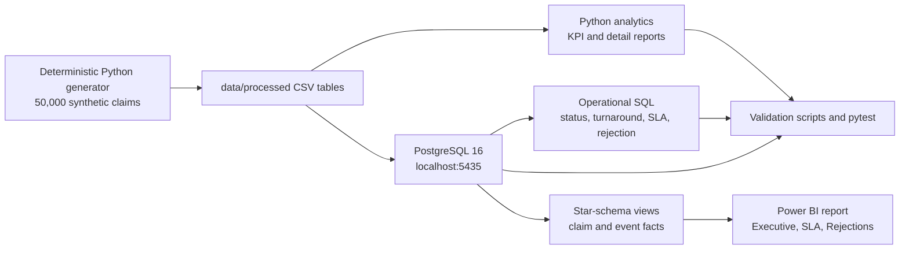

# Insurance Claims Operations Analytics & Bottleneck Detection

An independent Data Analyst / Product Operations Analyst portfolio project that
turns synthetic insurance claims data into an auditable operations monitoring
workflow. The project combines deterministic data generation, PostgreSQL,
Python analytics, SQL validation, and a three-page Power BI dashboard.

> **Synthetic-data disclaimer:** Every customer, policy, claim, event, SLA rule,
> KPI, and finding is synthetic. The results demonstrate analytical workflow and
> reporting discipline; they are not insurer, regulatory, or causal findings.

## Business Problem

Claims operations teams need to know where work is aging, which processing
stages are breaching service thresholds, whether differences are concentrated by
category or team, and which rejection reasons merit investigation. A useful
analysis must also make its denominators explicit and reconcile independent
calculation paths.

This project answers those questions for a reproducible snapshot of 50,000
claims as of `2026-10-31 23:59:59`.

## Objectives

- Build a normalized claims operations data model with enforceable integrity.
- Calculate claim status, approval, rejection, turnaround, backlog, and aging KPIs.
- Measure stage-level SLA performance using effective insurance-type rules.
- Separate completed-stage quality from overall exposure including active stages.
- Investigate category, team/region, stage, and rejection patterns.
- Deliver a validated Power BI report and evidence-based operational recommendations.

## Verified Snapshot

| KPI | Verified result |
| --- | ---: |
| Claims | 50,000 |
| PostgreSQL claim-stage events | 185,527 |
| Approved / rejected / open | 32,912 / 7,977 / 9,111 |
| Closed approval rate | 80.49% |
| Average closed turnaround | 125.16 hours |
| Open claims over 72 hours | 7,744 / 9,111 = 85.00% |
| Completed-stage SLA breaches | 59,722 / 176,416 = 33.85% |
| Overall-stage SLA breaches | 67,901 / 185,527 = 36.60% |

The completed-stage rate excludes active events. The overall rate uses the fixed
snapshot as the end time for active events and includes 8,179 active-stage
breaches. Both are valid, intentionally distinct measures.

## Technology Stack

- Python 3.11+ with pandas and NumPy
- PostgreSQL 16 via Docker Compose
- SQLAlchemy and psycopg for database access
- Power BI Desktop, PostgreSQL views, Power Query M, and DAX
- pytest for unit/integration validation
- Ruff for linting
- Windows PowerShell commands for the reproducible local workflow

## Architecture And Data Flow



See [`docs/ARCHITECTURE.md`](docs/ARCHITECTURE.md) for component details and
grain/relationship notes.

## Dataset And Schema

The generator creates six normalized tables:

| Table | Grain | Expected rows |
| --- | --- | ---: |
| `customers` | One customer | 16,667 |
| `teams` | One assigned operations team | 4 |
| `policies` | One policy | 25,000 |
| `claims` | One claim | 50,000 |
| `claim_events` | One claim processing-stage event | 185,527 |
| `sla_rules` | One effective insurance-type/stage rule | 16 |

The schema is defined in [`sql/001_schema.sql`](sql/001_schema.sql). Policies,
claims, and events use foreign keys; claims and events use chronology and status
constraints. The Power BI-friendly views in
[`sql/003_powerbi_star_schema.sql`](sql/003_powerbi_star_schema.sql) attach
effective SLA attributes to each event without copying data.

## Analytical Workflow

1. `claims-analytics generate --claims 50000 --seed 42` creates deterministic
   CSV inputs.
2. `claims-analytics analyze` calculates Python KPIs and exports report CSVs.
3. `claims-analytics init-db` creates the PostgreSQL schema.
4. `claims-analytics load-db` loads only the six standalone project tables.
5. [`sql/002_operational_queries.sql`](sql/002_operational_queries.sql) provides
   reusable status, closed-turnaround, active-SLA, and rejection analyses.
6. Validation scripts and integration tests reconcile keys, timestamps, counts,
   effective SLA joins, and Python/PostgreSQL results.

Stage SLA breaches use a strict `elapsed time > allowed_hours` comparison.
Completed events use `exited_at`; active events use the fixed snapshot. Claim
KPIs use distinct claim IDs so event-level fan-out cannot inflate counts.

## Power BI Dashboard

The saved report assets support three pages. Power BI Desktop visual rendering
and refresh still require a local Power BI session; automated checks validate
the source views, measures, report definitions, and fallback exports.

1. **Executive Overview**: total claims, closed approval rate, open backlog,
   average closed turnaround, aging, monthly trend, and category mix.
2. **SLA & Bottlenecks**: overall and completed-stage SLA rates, stage/team
   comparisons, completed duration, and overdue active-stage exceptions.
3. **Rejection Investigation**: rejection reason mix, category/team slices,
   claim detail, and investigation hypotheses.

Dashboard guidance is in [`powerbi/DESIGN_SPEC.md`](powerbi/DESIGN_SPEC.md),
[`powerbi/MEASURES.dax`](powerbi/MEASURES.dax), and
[`powerbi/IMPLEMENTATION_GUIDE.md`](powerbi/IMPLEMENTATION_GUIDE.md).

The saved `powerbi/claims_operations.pbix` is a 6.4 MB local binary and remains
ignored by Git. This avoids treating a desktop-specific, refresh-dependent file
as the reproducible source of the project. The PBIP report/semantic-model
definitions, SQL views, DAX, Power Query, and validation instructions provide a
reviewable source record; the original PBIX is not deleted or moved.

## Evidence-Based Findings

Detailed evidence and recommendations are in
[`reports/BUSINESS_INSIGHTS.md`](reports/BUSINESS_INSIGHTS.md). The key signals
are:

- 85.00% of open claims are older than 72 hours, making backlog aging the most
  immediate operational exposure.
- Verification has the highest overall stage breach rate at 36.87%; Decision is
  marginally highest on completed-only breach rate at 34.13%.
- Assessment has the longest completed-stage duration at 55.10 hours.
- Health contributes 26,725 overall breaches, 39.36% of all breaches, and has
  the longest average closed turnaround at 142.78 hours.
- Home has the highest normalized overall category breach rate at 37.28%.
- Team breach rates vary by only 0.31 percentage points, so no major team outlier
  is established by this snapshot.
- Rejection reasons are nearly even: Missing documents leads with 2,018 of
  7,977 rejected claims, or 25.30%.

These are descriptive associations in synthetic data. They do not prove causes,
savings, staffing requirements, or policy changes.

## Setup: Windows, Python, Docker, PostgreSQL, Power BI

### Python and reports

Requirements: Python 3.11+, VS Code, and PowerShell.

```powershell
cd insurance-claims-analytics
py -m venv .venv
.\.venv\Scripts\Activate.ps1
python -m pip install -e ".[dev]"
Copy-Item .env.example .env
claims-analytics generate --claims 50000 --seed 42
claims-analytics analyze
pytest -q
```

The generated CSV data and reports are local working artifacts and are ignored
by Git. Run `--claims 200` for a quicker development check; do not use that
smaller dataset for the verified portfolio metrics.

If PowerShell blocks activation:

```powershell
.venv\Scripts\python.exe -m pip install -e ".[dev]"
.venv\Scripts\claims-analytics.exe generate --claims 200
```

### PostgreSQL with Docker

Install Docker Desktop, then start the project database:

```powershell
claims-analytics init-db
Measure-Command { claims-analytics load-db }
python scripts/validate_data.py
```

The database uses `localhost:5435`, database `claims_analytics`, user
`claims_user`, and the local-development password in `.env.example`. Never
point `DATABASE_URL` at another project's database. `load-db` reloads only the
six standalone project tables in foreign-key order.

Run the reusable SQL report with a PostgreSQL client:

```powershell
psql -h localhost -p 5435 -U claims_user -d claims_analytics -f .\sql\002_operational_queries.sql
```

### Power BI Desktop

1. Ensure Docker PostgreSQL is running on `localhost:5435`.
2. Create the views with `sql/003_powerbi_star_schema.sql` if needed.
3. In Power BI Desktop, select **Get data > PostgreSQL database**.
4. Use server `localhost:5435`, database `claims_analytics`, and Import mode.
5. Import the six `vw_dim_*` and `vw_fact_*` views.
6. Apply the relationships and measures in `powerbi/DESIGN_SPEC.md` and
   `powerbi/MEASURES.dax`.
7. Compare unfiltered cards to `reports/kpi_summary.csv` before saving.

Do not commit database credentials, screenshots containing secrets, or local
Power BI settings. See [`docs/screenshots/README.md`](docs/screenshots/README.md)
for portfolio screenshot naming guidance and the captured page previews:

- [Executive Overview](docs/screenshots/01_executive_overview.png)
- [SLA & Bottlenecks](docs/screenshots/02_sla_bottlenecks.png)
- [Rejection Investigation](docs/screenshots/03_rejection_investigation.png)

## Validation Commands

Run the complete automated checks from the project root:

```powershell
# DATABASE_URL is read from the ignored local .env file.
$env:RUN_POSTGRES_INTEGRATION='1'
.\.venv\Scripts\pytest.exe -q
.\.venv\Scripts\ruff.exe check .
.\.venv\Scripts\python.exe scripts\validate_data.py
.\.venv\Scripts\python.exe scripts\validate_powerbi_assets.py
```

The integration suite is opt-in so ordinary `pytest -q` does not require
Docker. The verified project state is 16 passing tests, passing Ruff, passing
data validation, and passing fallback Power BI asset validation.

## Project Structure

```text
src/insurance_analytics/     Python generator, analytics, CLI, database tools
sql/                          PostgreSQL schema, operational SQL, star-schema views
tests/                        Unit, data, Power BI asset, and PostgreSQL tests
data/processed/               Local generated CSV inputs; ignored by Git
reports/                      Local CSV outputs and checked-in Markdown reports
powerbi/                      DAX, Power Query, design docs, PBIX/PBIP assets
scripts/                      Data and fallback asset validation scripts
docs/                         Architecture, portfolio, and screenshot guidance
docker-compose.yml            PostgreSQL 16 local service on port 5435
pyproject.toml                Packaging, dependencies, pytest, and Ruff settings
```

## Limitations And Future Considerations

- All data is synthetic and the SLA thresholds are illustrative, not regulatory.
- This is a single fixed snapshot, not a production trend or forecast.
- The data lacks staffing, complexity, rework, intake channel, document
  completeness, claimant geography, and case-level causal fields.
- Team region is assigned-team region, not customer location.
- Descriptive differences do not prove causality or justify untested savings.
- Future work could add multiple snapshots, richer workflow reason codes,
  documented data contracts, and authenticated deployment controls.

## Portfolio Positioning

This is a self-directed, reproducible synthetic-data portfolio project. Use
[`docs/PORTFOLIO_SUMMARY.md`](docs/PORTFOLIO_SUMMARY.md) for a concise project
description and resume-ready bullets based only on implemented work.
