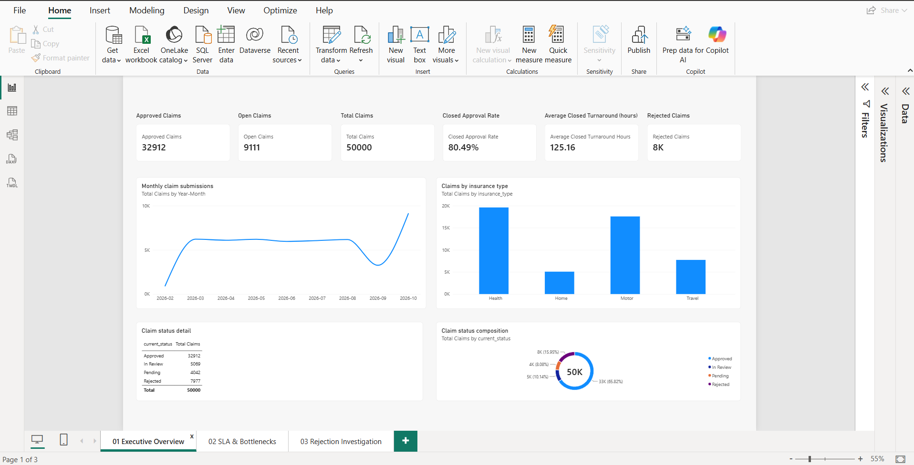
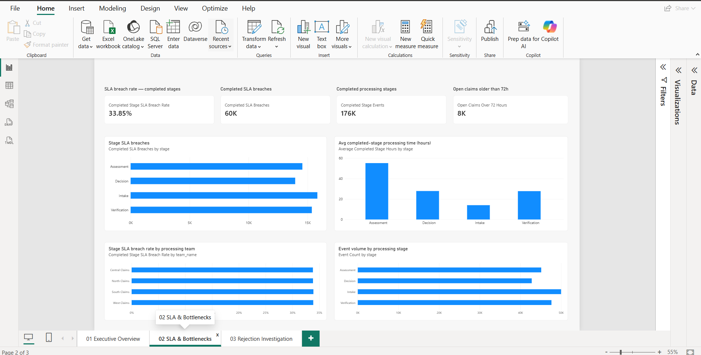
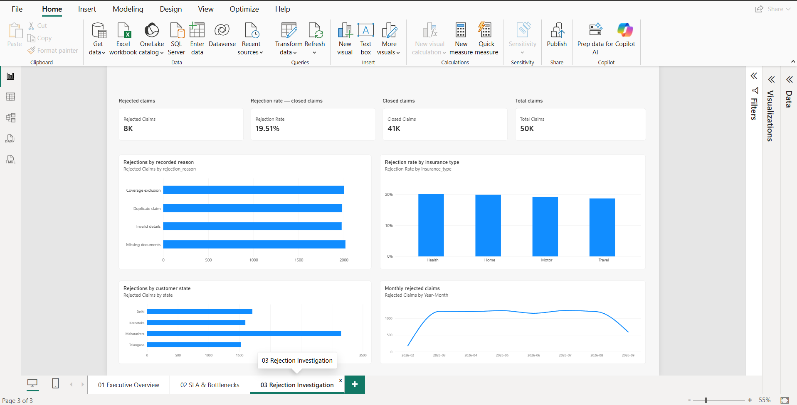
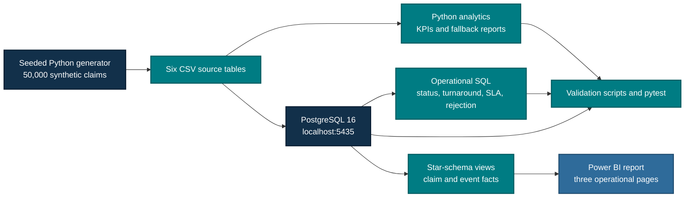

# Insurance Claims Operations Analytics & Bottleneck Detection

**A reproducible Data Analyst portfolio project for turning claims workflow data into operational priorities.**

This project generates a deterministic synthetic insurance-claims snapshot, validates it through Python and PostgreSQL, and presents the results in a three-page Power BI report. It focuses on backlog aging, stage-level SLA exposure, throughput, rejection patterns, and measurement discipline.

[](https://www.python.org/)
[](https://www.postgresql.org/)
[](sql/002_operational_queries.sql)
[](powerbi/claims_operations_final.pbix.pbip)
[](https://pandas.pydata.org/)
[](tests/)



## At A Glance

| Project signal | Verified result |
| --- | ---: |
| Synthetic claims analyzed | **50,000** |
| Claim-stage events | **185,527** |
| Power BI report pages | **3** |
| Default automated test run | **14 passed, 2 skipped** |
| Prior PostgreSQL-enabled run | **16 passed** |
| Reporting snapshot | **2026-10-31 23:59:59** |

> **Synthetic-data disclaimer:** Every customer, policy, claim, event, SLA rule, KPI, and finding is synthetic. The results demonstrate analytical workflow and reporting discipline; they are not insurer, regulatory, causal, or financial findings.

## Project Overview

Claims operations teams need to identify where work is aging, which stages are exceeding service thresholds, whether patterns vary by category or team, and which recorded rejection reasons warrant investigation. The project addresses those questions with an auditable workflow from generated source tables to validated metrics and dashboard-ready views.

### Business Questions

- How large is the open backlog, and how much of it is aged beyond 72 hours?
- Which processing stages have the highest SLA exposure or longest completed duration?
- Are differences concentrated by insurance type, assigned team, or region?
- What do the recorded rejection reasons suggest for the next investigation?
- Do claim-level KPIs remain correct when claim events create one-to-many fan-out?

## Verified Snapshot

| KPI | Result | Definition |
| --- | ---: | --- |
| Approved / rejected / open claims | **32,912 / 7,977 / 9,111** | Current claim status |
| Closed approval rate | **80.49%** | 32,912 approved / 40,889 closed |
| Average closed turnaround | **125.16 hours** | Average `closed_at - submitted_at` across closed claims |
| Open claims over 72 hours | **7,744 / 9,111 = 85.00%** | Open claims older than the monitoring threshold |
| Overall-stage SLA breach rate | **67,901 / 185,527 = 36.60%** | Completed and active eligible stage events |
| Completed-stage SLA breach rate | **59,722 / 176,416 = 33.85%** | Completed eligible events only |

SLA breach means elapsed time is **strictly greater than** the effective rule's `allowed_hours`. Completed events use `exited_at`; active events use the fixed reporting timestamp. Claim KPIs use distinct claim IDs so event-level fan-out cannot inflate counts.

### Why The SLA Denominators Matter

The two SLA measures answer different operational questions:

- **Completed-stage quality:** `59,722 / 176,416 = 33.85%`; active events are excluded.
- **Overall operational exposure:** `67,901 / 185,527 = 36.60%`; active events are evaluated at the snapshot and included.
- **Active-stage component:** `8,179 / 9,111 = 89.77%`; current active events already beyond their effective thresholds.

These are intentionally distinct definitions, not a calculation disagreement. Full reconciliation is documented in [`reports/FINAL_VALIDATION.md`](reports/FINAL_VALIDATION.md).

## Dashboard Preview

### 01 · Executive Overview

Portfolio volume, closed approval, open backlog, turnaround, aging, monthly trend, and insurance-type mix.


### 02 · SLA & Bottlenecks

Stage and team comparisons, completed duration, SLA exposure, and overdue active-stage exceptions.



### 03 · Rejection Investigation

Recorded rejection reasons, category and team slices, and claim-level investigation detail.



The images are authentic Power BI captures. See [`docs/screenshots/README.md`](docs/screenshots/README.md) for page mapping and capture guidance.

## Findings Worth Investigating

| Signal | Verified evidence | Interpretation |
| --- | --- | --- |
| Aged open backlog | **85.00%** of open claims are over 72 hours | The immediate exposure is active-work aging, not only completed-case quality. |
| Verification SLA | **17,564 / 47,632 = 36.87%** overall stage breach rate | Highest overall stage breach rate in the snapshot; a queue and handoff investigation candidate. |
| Assessment duration | **55.10 hours** average completed-stage duration across 42,780 events | Longest completed stage duration, despite not having the highest breach rate. |
| Category concentration | Health contributes **26,725** overall breaches; Home has the highest normalized rate at **37.28%** | Volume and rate point to different follow-up questions. |
| Team comparison | Breach-rate spread is **0.31 percentage points** | This snapshot does not establish a major team outlier. |

These are descriptive signals in synthetic data. They do not establish root cause, staffing requirements, savings, or policy changes. See [`reports/BUSINESS_INSIGHTS.md`](reports/BUSINESS_INSIGHTS.md) for the full evidence table and recommendations.

## Reproducible Architecture



The design keeps claim-level facts separate from stage-event facts. PostgreSQL views resolve effective SLA rules by insurance type, stage, and event-entry date; DAX and Python preserve the same completed-versus-overall SLA distinction. See [`docs/ARCHITECTURE.md`](docs/ARCHITECTURE.md) for grain, relationships, and validation boundaries.

## Technology And Methods

| Area | Implementation |
| --- | --- |
| Data generation | Deterministic Python generator with `seed=42` and a fixed reporting timestamp |
| Data preparation | pandas and NumPy; six normalized CSV tables |
| Database | PostgreSQL 16 through Docker Compose on host port `5435` |
| SQL analysis | Constrained schema, operational queries, effective-rule SLA joins, star-schema views |
| Power BI | Power Query M, DAX measures, PBIP report/semantic-model definitions, three pages |
| Quality checks | pytest, Ruff, key/foreign-key validation, chronology checks, KPI reconciliation, fallback Power BI asset validation |
| Analytical methods | Distinct-claim KPIs, event-grain SLA rates, aging thresholds, stage/team/category comparisons, descriptive rejection analysis |

## Windows Setup

### 1. Create the Python environment

Requirements: Python 3.11+, Git, Docker Desktop, PowerShell, and Power BI Desktop for report refresh and visual verification.

```powershell
git clone <repository-url>
Set-Location insurance-claims-analytics
py -m venv .venv
.\.venv\Scripts\Activate.ps1
python -m pip install -e ".[dev]"
Copy-Item .env.example .env
```

The `.env` file is ignored by Git. Do not replace it with credentials from another project or commit it.

### 2. Generate the verified local snapshot

```powershell
claims-analytics generate --claims 50000 --seed 42
claims-analytics analyze
```

Generated CSV inputs and reports are local working artifacts and are ignored by Git. Use `--claims 200` for a quick development check, but do not use that smaller dataset for the verified portfolio metrics.

### 3. Start PostgreSQL and load the six project tables

```powershell
docker compose up -d
claims-analytics init-db
claims-analytics load-db
python scripts/validate_data.py
```

The local Docker service exposes PostgreSQL at `localhost:5435`. `load-db` reloads only the six standalone project tables in foreign-key order. Create the Power BI views if needed:

```powershell
psql -h localhost -p 5435 -U claims_user -d claims_analytics -f .\sql\003_powerbi_star_schema.sql
```

### 4. Open Power BI Desktop

1. Open `powerbi/claims_operations_final.pbix.pbip` or the saved local PBIX if available.
2. Ensure PostgreSQL is running and refresh the report.
3. Connect to `localhost:5435`, database `claims_analytics`, using Import mode.
4. Import the six `vw_dim_*` and `vw_fact_*` views if building from the source definitions.
5. Apply the relationships and measures in [`powerbi/DESIGN_SPEC.md`](powerbi/DESIGN_SPEC.md) and [`powerbi/MEASURES.dax`](powerbi/MEASURES.dax).
6. Compare unfiltered cards with the verified snapshot above before saving.

The binary PBIX is a local, refresh-dependent artifact and is intentionally ignored by Git. The reviewable project record is the PBIP definition, SQL, DAX, Power Query, Python source, tests, screenshots, and documentation.

## Validation

The default Python test suite and Ruff do not require Docker. The data and Power BI asset validators expect the generated local CSV/report artifacts from the setup steps above:

```powershell
.\.venv\Scripts\pytest.exe -q
.\.venv\Scripts\ruff.exe check .
.\.venv\Scripts\python.exe scripts\validate_data.py
.\.venv\Scripts\python.exe scripts\validate_powerbi_assets.py
```

Current verified results:

- Default suite: **14 passed, 2 skipped**.
- Prior PostgreSQL-enabled suite: **16 passed** with `RUN_POSTGRES_INTEGRATION=1`; those integration tests reload project tables and are opt-in.
- Ruff: **passed**.
- Data and fallback Power BI asset validation: **passed**.

Technical details and the exact prior database-enabled run are in [`reports/TECHNICAL_VALIDATION.md`](reports/TECHNICAL_VALIDATION.md). The final release review is in [`reports/PRE_COMMIT_REVIEW.md`](reports/PRE_COMMIT_REVIEW.md).

## Repository Guide

| Path | Purpose |
| --- | --- |
| [`src/insurance_analytics/`](src/insurance_analytics/) | Generator, analytics, configuration, CLI, and database loader |
| [`sql/`](sql/) | PostgreSQL schema, operational queries, and Power BI views |
| [`powerbi/`](powerbi/) | DAX, Power Query, design guidance, PBIP report, and semantic model |
| [`tests/`](tests/) | Unit, data, Power BI asset, and opt-in PostgreSQL integration tests |
| [`scripts/`](scripts/) | Data and fallback Power BI validation scripts |
| [`reports/BUSINESS_INSIGHTS.md`](reports/BUSINESS_INSIGHTS.md) | Detailed findings, denominators, recommendations, and limitations |
| [`reports/FINAL_VALIDATION.md`](reports/FINAL_VALIDATION.md) | KPI and SLA reconciliation |
| [`docs/ARCHITECTURE.md`](docs/ARCHITECTURE.md) | Component flow, data grain, relationships, and validation boundaries |
| [`powerbi/IMPLEMENTATION_GUIDE.md`](powerbi/IMPLEMENTATION_GUIDE.md) | Detailed PostgreSQL-to-Power BI Desktop workflow |
| [`docs/PORTFOLIO_SUMMARY.md`](docs/PORTFOLIO_SUMMARY.md) | Concise portfolio and resume-ready project summary |

## Evidence Limits

- The dataset is synthetic and represents one fixed snapshot, not a production trend or forecast.
- SLA thresholds are illustrative, not regulatory or contractual.
- The data does not model staffing, case complexity, rework, intake channel, document completeness, claimant geography, or monetary outcomes.
- Region means assigned-team region, not customer location.
- Descriptive group differences do not prove causality.
- Recorded rejection reasons are investigation candidates, not confirmed root causes.

The project is designed to show disciplined analytical reasoning, transparent denominators, reproducible validation, and clear communication of uncertainty.
