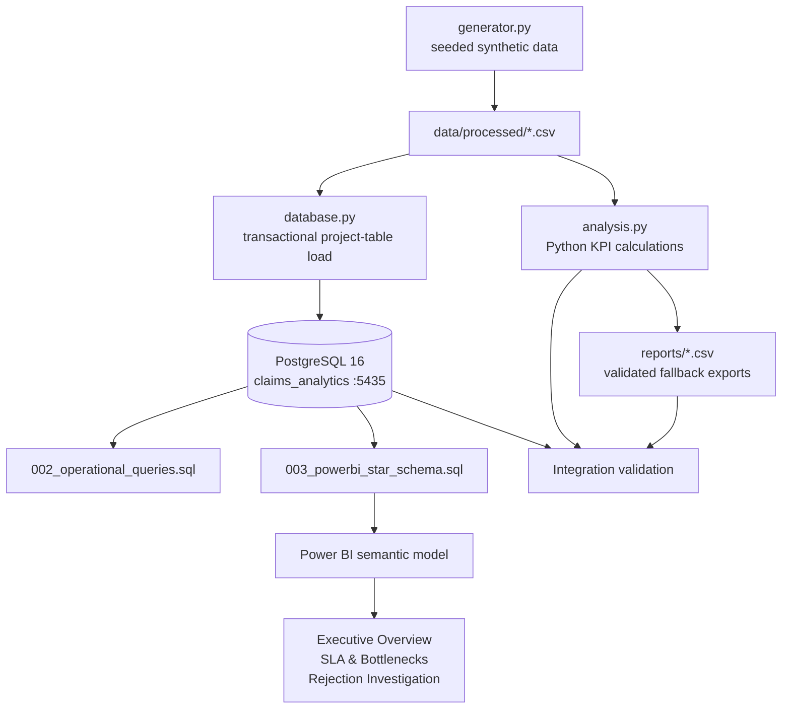

# Architecture

## Purpose

This project is a local, reproducible analytics workflow for a synthetic
insurance claims operation. The architecture keeps claim-level facts separate
from stage-event facts so claim KPIs are not multiplied by event fan-out.

## Data Flow



## Components

### Synthetic data generator

`src/insurance_analytics/generator.py` creates deterministic normalized tables
with `seed=42` and a fixed reporting timestamp of `2026-10-31 23:59:59`.
Closed claims have all completed stages. Open claims have one active stage.

### Python analytics

`src/insurance_analytics/analysis.py` loads the six CSV tables, joins claims to
policies and teams, resolves effective SLA rules by insurance type/stage/date,
and exports claim, event, KPI, stage, team, monthly, and rejection reports.

The Python workflow explicitly reports both:

- Completed-stage SLA: completed breaches / completed events.
- Overall-stage SLA: all breaches / all eligible events, with active events
  evaluated at the snapshot.

### PostgreSQL

`sql/001_schema.sql` creates six constrained tables. The Docker service exposes
PostgreSQL on host port `5435` and uses the dedicated `claims_analytics` database.
`src/insurance_analytics/database.py` loads only the six standalone project
tables and does not manage external schemas.

### Analytical SQL

`sql/002_operational_queries.sql` contains reusable queries for status by
category, closed turnaround, active-stage SLA monitoring, and rejection reasons.
All SLA joins use the effective rule at event entry and a strict greater-than
comparison against `allowed_hours`.

### Power BI views and model

`sql/003_powerbi_star_schema.sql` exposes dimension and fact views:

- `vw_dim_customer`
- `vw_dim_team`
- `vw_dim_policy`
- `vw_dim_sla_rule`
- `vw_fact_claim`, one row per claim
- `vw_fact_claim_event`, one row per stage event with resolved SLA attributes

The recommended relationships are single-direction dimension-to-fact paths and
a one-to-many claim-to-event drill-through path. Claim measures use
`DISTINCTCOUNT(claim_id)`; event measures use event rows. SLA rules are resolved
in the view rather than through a second ambiguous relationship.

## Grain And Key Relationships

```text
customers (customer_id)
    1 -> many policies (policy_id)
policies (policy_id)
    1 -> many claims (claim_id)
teams (team_id)
    1 -> many claims (assigned_team_id)
teams (team_id)
    1 -> many claim_events (team_id)
claims (claim_id)
    1 -> many claim_events (claim_id)
sla_rules
    resolved into claim_events by insurance_type + stage + effective entry date
```

## Validation Boundaries

Validation is deliberately layered:

1. Python tests check deterministic generation, key uniqueness, referential
   integrity, chronology, and metric reconciliation.
2. PostgreSQL integration tests check idempotent schema/load behavior, all six
   table counts, orphan and timestamp conditions, view counts, and both SLA
   definitions.
3. Fallback asset validation checks report CSV shape, uniqueness, expected row
   counts, and verified KPI values.
4. Power BI Desktop rendering and interaction remain manual checks.

See [`reports/TECHNICAL_VALIDATION.md`](../reports/TECHNICAL_VALIDATION.md) and
[`reports/FINAL_VALIDATION.md`](../reports/FINAL_VALIDATION.md) for the current
verified results.

## Local Security And Reproducibility

`.env` contains local connection settings and is ignored. `.env.example` gives
the expected local URL without requiring credentials to be embedded in code.
Generated CSVs, caches, Power BI local settings, and the binary PBIX are local
artifacts. The analytical source, SQL, DAX, validation tests, and Markdown
reports are the reproducible project record.
