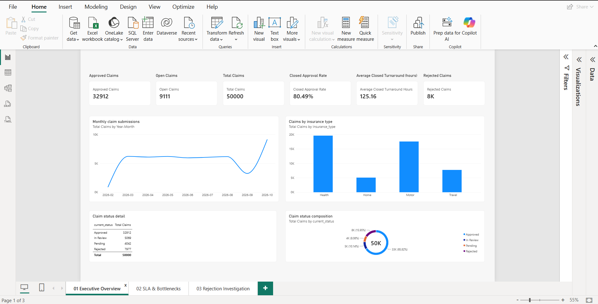
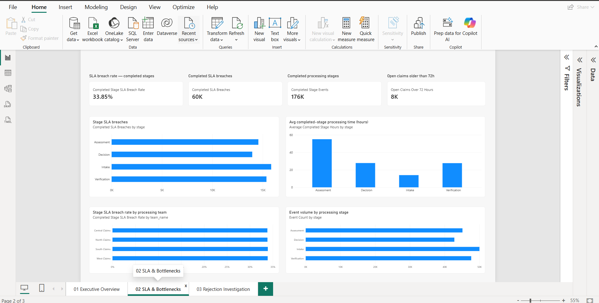
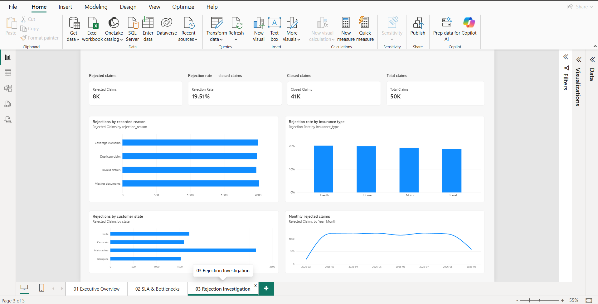

# Dashboard Screenshots

This directory contains the three authentic screenshots captured from the saved
Power BI report. The existing `reports/exploratory/*.png` files are Python
exploratory charts, not Power BI page captures, and should not be presented as
dashboard screenshots.

## Capture Procedure

1. Open `powerbi/claims_operations.pbix` or the corresponding PBIP project in
   Power BI Desktop.
2. Start the local PostgreSQL service on `localhost:5435` if a refresh is needed.
3. Refresh the report and confirm the page is in the intended unfiltered state.
4. Capture only the report canvas, excluding credentials, desktop notifications,
   personal paths, or unrelated applications.
5. Resize or crop consistently so all three images use the same aspect ratio.
6. Save the authentic captures with these exact names:

```text
docs/screenshots/01_executive_overview.png
docs/screenshots/02_sla_bottlenecks.png
docs/screenshots/03_rejection_investigation.png
```

## Page Mapping

| Filename | Power BI page |
| --- | --- |
| `01_executive_overview.png` | Executive Overview |
| `02_sla_bottlenecks.png` | SLA & Bottlenecks |
| `03_rejection_investigation.png` | Rejection Investigation |

## Captured Screenshots







Before sharing a screenshot, check that synthetic-data labeling is visible or
included in the surrounding portfolio context. Do not fabricate or recreate a
dashboard image outside Power BI Desktop. If screenshots are committed, review
their file size and remove any credentials or local connection details.
